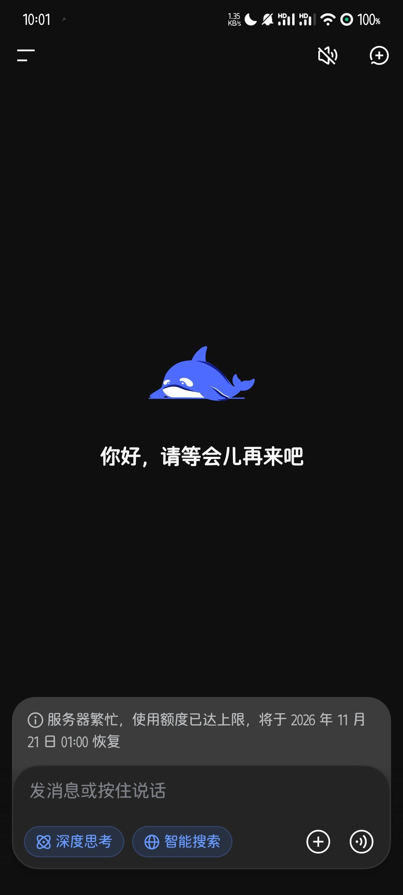
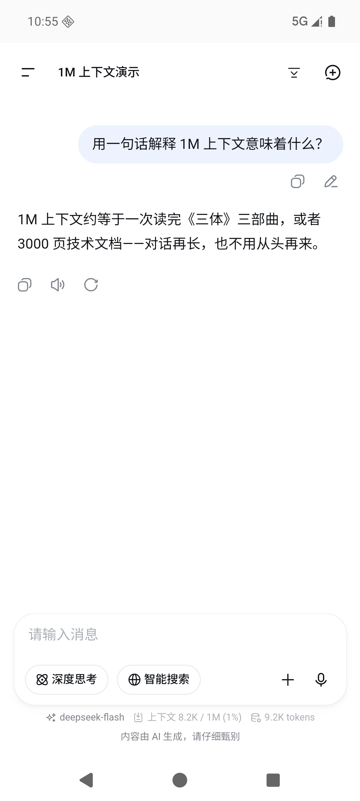

<p align="center">
  <a href="https://github.com/moyuer233/deepseek-chat-demo-android">
    
  </a>
</p>

<h1 align="center">DeepSeek Chat Demo</h1>

<p align="center"><i>A “free-tier” DeepSeek on your own API: no throttling, and your history comes along.</i></p>

<p align="center">
  <a href="https://github.com/moyuer233/deepseek-chat-demo-android/releases/latest"></a>
  <a href="https://github.com/moyuer233/deepseek-chat-demo-android/actions/workflows/ci.yml"></a>
  <a href="https://github.com/moyuer233/deepseek-chat-demo-android/blob/main/LICENSE"></a>
  <a href="https://github.com/moyuer233/deepseek-chat-demo-android/releases"></a>
</p>

<p align="center"><b>English</b> | <a href="README.zh-CN.md">简体中文</a></p>

> **Positioning**: a “free-tier DeepSeek” on your own API — your key, your quota, no free-tier throttling — an independent project with full history import, built on chat-demo.
>
> Not a chat-demo fork: it reuses chat-demo's web core (MIT). Unofficial; not affiliated with, endorsed by, or sponsored by DeepSeek.

## What it is

A DeepSeek client on your phone: it calls `api.deepseek.com` with **your own API key or account grant**, so the quota and billing are yours and the official free tier's throttling does not apply. At the same time it brings your whole chat.deepseek.com history onto the device — browsable and exportable.

- **“Free-tier” experience, your API account**: free-tier shape, your own API bill.
- **Independent project**: not a fork; only the chat-demo web core is reused (MIT).
- **History import**: export a ZIP from chat.deepseek.com, import every conversation, keep it in local IndexedDB, export it again any time.
- **1M context**: the status line shows “context 8.2K / 1M”; near the limit only older turns are compacted on-device, originals are kept.

## No throttling, how

| Official free tier: wait for the quota | This app: 1M context, keep chatting |
| --- | --- |
|  |  |

The free tier throttles you and asks you to wait (left). This app bypasses that entrance: it calls the API directly with your key or grant (right), and shows context usage plus tokens under the composer.

To be clear: API calls are metered against your own account. “Free tier” means the experience, not zero cost.

## Screens

<p align="center">
  
  
</p>

## Features

**Chat**
- DeepThink, web search, image and file upload, read-aloud, voice input.
- Markdown: code, tables, math, Mermaid diagrams, citations.
- Message tree and branch switching, regenerate, edit and resend, continue, copy, vote, share.

**Sessions and history**
- New, rename, delete, search; grouped as Today / Yesterday / 7 Days / 30 Days.
- Import every conversation from chat.deepseek.com, with a diff preview (added / updated / local-only).
- Export to `deepseek_data-*.zip` and import it again.
- Context compaction, manual or automatic; local originals are kept.

**Account and top-up**
- Sign in to chat.deepseek.com once for history import; chat with the DeepSeek account grant (no key) or a manual API key.
- Balance and bonus in the account page; the built-in top-up page detects the payment QR and opens the WeChat or Alipay app you picked.
- Optional Scan assist: an accessibility service that taps “Scan → Album” within 20 seconds, off by default.

**Native shell**
- Plain WebView plus `window.NativeShell`, no Capacitor bridge. Back goes up one level, right-swipe opens the sidebar, left-swipe closes it.
- Camera, gallery, files and microphone use the system UI. Release builds use R8 and resource shrinking; the APK is about 2.9 MB.

## Moving your history over

1. Open [chat.deepseek.com](https://chat.deepseek.com) in a browser and export your chats to a ZIP.
2. Install this app from [Releases](https://github.com/moyuer233/deepseek-chat-demo-android/releases) (or build it below).
3. Settings → Data → Import chat history, pick the ZIP, check the diff (added / updated / local-only) and import.
4. Settings → Account → sign in with your DeepSeek account (account grant) or paste an API key. Then just chat.

Local data stays on the device; exported ZIP files are yours to keep.

## Download

Grab the APK from [Releases](https://github.com/moyuer233/deepseek-chat-demo-android/releases). Self-signed, Android 7.0+.

- **1.1.0 (current, native)** — the Compose shell in `native-app/` around the chat-demo web core, with native bridges for account grant, import/export, camera/files and the optional accessibility scan assist.
- **0.2.x (legacy)** — the early Capacitor wrapper, kept for history.

## Build

Node.js, pnpm, JDK 21 and Android SDK 36. From the repository root:

```bash
pnpm install
pnpm build

# copy the web bundle into the native shell
rm -rf native-app/app/src/main/assets/web
mkdir -p native-app/app/src/main/assets/web
cp -r dist/. native-app/app/src/main/assets/web/

cd native-app
./gradlew assembleRelease   # signing config: native-app/keystore.properties
```

Debug build: `cd native-app && ./gradlew assembleDebug`, output in `app/build/outputs/apk/debug/`.

## Structure

- `src/` — the chat-demo web client (React 18 + rspack).
- `native-app/` — the Android shell (Kotlin/Compose, WebView and the NativeShell bridge).
- `copy/文案.mjs` — the single source of UI copy for web and native; run `node scripts/gen-copy.mjs`.
- `docs/` — screenshots and research notes.

## Licence and privacy

MIT, with the upstream LICENSE and attribution kept. The DeepSeek name and logo belong to DeepSeek; this project uses them only for an unofficial client.

- Scan assist is an optional accessibility service, off by default. It is active only for 20 seconds after the top-up flow opens WeChat/Alipay and does not read or store chats or payment details.
- Voice input needs microphone permission; images and files use the system pickers.
- Chats stay on the device; no account password is stored, and the grant token is encrypted with Android Keystore.
