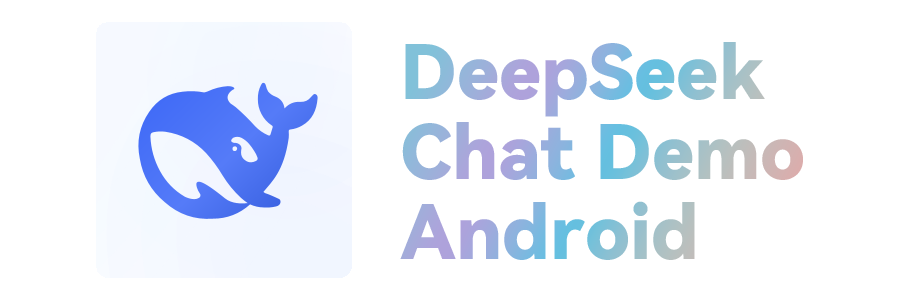
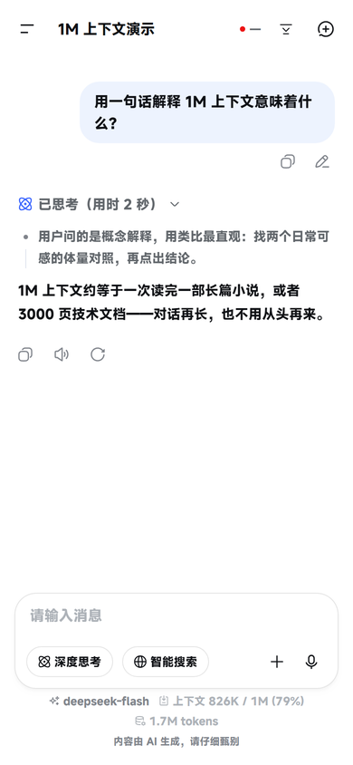
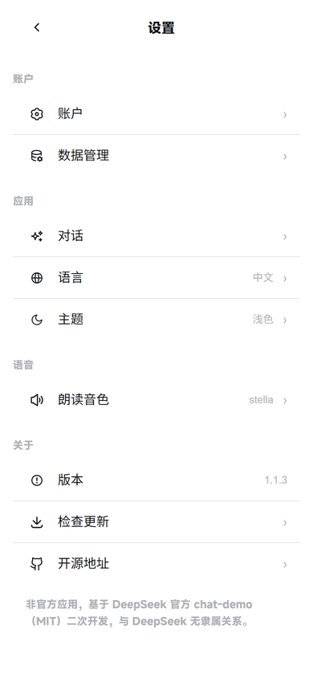
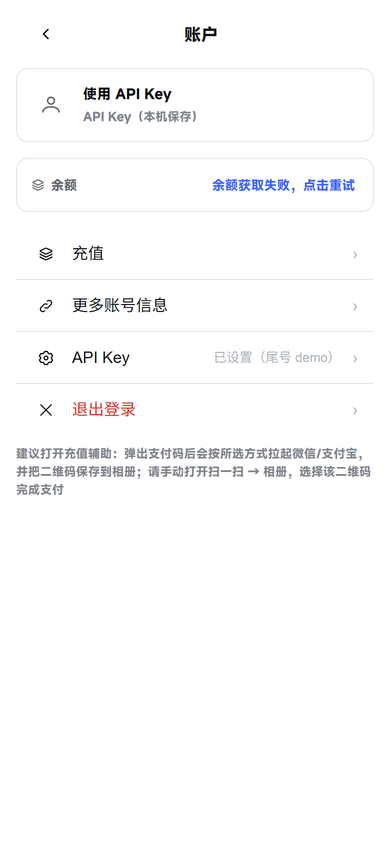

<p align="center">
  
</p>

<div align="center">

<b>English</b> ｜ <a href="README.zh-CN.md">简体中文</a>

<br>

<div>
<a href="https://github.com/moyuer233/deepseek-chat-demo-android/releases/latest"></a>
<a href="https://github.com/moyuer233/deepseek-chat-demo-android/actions/workflows/ci.yml"></a>
<a href="https://github.com/moyuer233/deepseek-chat-demo-android/blob/main/LICENSE"></a>
<a href="https://github.com/moyuer233/deepseek-chat-demo-android/releases"></a>
<a href="https://github.com/moyuer233/deepseek-chat-demo-android/releases"></a>
<a href="https://github.com/moyuer233/deepseek-chat-demo-android/releases"></a>
<a href="https://github.com/moyuer233/deepseek-chat-demo-android/releases/latest"></a>
<a href="https://github.com/moyuer233/deepseek-chat-demo-android/releases"></a>
<a href="https://github.com/moyuer233/deepseek-chat-demo-android/commits/main"></a>
<a href="https://github.com/moyuer233/deepseek-chat-demo-android/stargazers"></a>
</div>

<br>

<a href="https://moyuer233.github.io/deepseek-chat-demo-android/">Website</a> ｜
<a href="https://github.com/moyuer233/deepseek-chat-demo-android/releases">Download</a> ｜
<a href="https://github.com/moyuer233/deepseek-chat-demo-android/issues">Issues</a> ｜
<a href="https://github.com/deepseek-ai/chat-demo">Upstream chat-demo</a>

</div>

DeepSeek Chat Demo Android is an open-source, unofficial Android client: chat with **your own API key or DeepSeek Platform account grant**, so the quota and the bill stay on your account and the free tier's throttling does not apply. It also imports your whole chat.deepseek.com history onto the device and exports it again whenever you want. The web core is chat-demo (MIT); the native shell is Kotlin + Compose.


## 🆚 How it differs from the official app

Every chat feature the official app has — DeepThink, web search, attachments, read-aloud, voice input, message branches, session management — is here too, so it is not listed again. What follows is only what is different.

| | Official app | This project |
| --- | --- | --- |
| Quota | Free tier, queue for recovery once used up | **Your own API quota**; not routed through the free-tier limiter |
| Context | Limited by plan | **1M**, with live usage in the status line; near the limit only older turns are compacted on-device, **originals never deleted** |
| History | Stays in your official account | **Imported onto the device**, with a diff preview first, and exportable again as a ZIP |
| Payment | In-app purchase | Opens the official top-up page, reads the payment QR, then launches WeChat or Alipay (optional scan assist) |
| Core | Closed source | **Open source** under AGPL-3.0: chat-demo (MIT) web core, Kotlin + Compose shell |

## 📱 Screens

<table>
  <tr>
    <td align="center"><br />Chat: context usage in the status line</td>
    <td align="center"><br />Sidebar: search and time-grouped chats</td>
  </tr>
  <tr>
    <td align="center"><br />Settings: account, app, voice, about</td>
    <td align="center"><br />Account: balance, top-up, API key</td>
  </tr>
</table>

## 🚀 Quick start

### 📦 Install

Download the APK from [Releases](https://github.com/moyuer233/deepseek-chat-demo-android/releases) — current **1.1.3**, versionCode 9, about 2.9 MB, self-signed, Android 7.0+. Then either paste your own API key or authorize with a DeepSeek Platform account (no key needed).

### 🛠️ Build from source

Node.js, pnpm, JDK 21 and Android SDK 36 are required:

```bash
pnpm install && pnpm build
rm -rf native-app/app/src/main/assets/web && mkdir -p native-app/app/src/main/assets/web
cp -r dist/. native-app/app/src/main/assets/web/
cd native-app && ./gradlew assembleRelease   # signing config in native-app/keystore.properties
```

### 🗂️ Import your history

1. Open [chat.deepseek.com](https://chat.deepseek.com) in a browser and export your chats to a ZIP.
2. In the app: Settings → Data → Import chat history, pick the ZIP.
3. Review the added / updated / local-only diff and import.

## 📁 Layout

| Path | What it is |
| --- | --- |
| `src/` | the chat-demo web client (React 18 + rspack) |
| `native-app/` | the Android shell (Kotlin + Compose + WebView + `window.NativeShell` bridge) |
| `copy/文案.mjs` | single source of UI copy for web and native; `node scripts/gen-copy.mjs` generates the rest |
| `site/` | the static website published on GitHub Pages |
| `docs/` | screenshots and research notes |

## ⚠️ Known limitations

- Long chats render the latest 25 messages and load earlier ones on demand; virtual scrolling is not implemented yet.
- There is no automated test suite; regressions rely on manual checks and code review.
- The top-up page only returns a UnionPay aggregate QR; the WeChat/Alipay channel is inferred from the selected button and the QR payload.

## 📝 Notes

- Chat requests go straight to `api.deepseek.com`; nothing is relayed through a server owned by this project. Usage is billed to your own account.
- Chats and imported history stay in the device's IndexedDB; sign-in happens on the official page, the app never sees your password, and the grant token is encrypted with Android Keystore.
- Scan assist is an optional accessibility service, off by default, active only for 20 seconds after the top-up flow opens WeChat/Alipay, and it does not read or store chats or payment details.

## ⭐ Star history

<a href="https://star-history.com/#moyuer233/deepseek-chat-demo-android&Date">
  
</a>

## ❤️ Funding

This is a spare-time project with no commercial sponsorship. If it helped you, there is one tip jar:

<a href="https://afdian.com/a/moyuer233">
  
</a>

## 🤝 Contributing

- **Bugs**: open an [issue](https://github.com/moyuer233/deepseek-chat-demo-android/issues) with steps to reproduce, device and Android version, and the app version (Settings → About).
- **Code**: open an issue describing the change first, then send a PR; run `pnpm type && pnpm lint && pnpm build` before pushing.
- **Copy**: all UI copy lives in `copy/文案.mjs`; run `node scripts/gen-copy.mjs` after editing it, and do not hand-edit the generated `src/i18n/*.ts` or `NativeCopy.kt`.
- **Commit messages**: one line saying what changed; no emoji, no filler like "minor improvements".
- **Please don't**: commit build output, keystores, `.scratch/`, or machine-specific paths.

## 📄 Licence

This project is licensed under the **GNU AGPL-3.0** (AGPL-3.0-or-later) © moyuer233.

That means you may use, modify and redistribute it freely, but **any distribution must ship the complete corresponding source** (build scripts included), and **if you run a modified version as a network service, you must offer its source to those users** — section 13 of the AGPL exists precisely to close the "open source in, closed SaaS out" loophole.

The web core is reused from the MIT-licensed [chat-demo](https://github.com/deepseek-ai/chat-demo), whose original notice is kept in [NOTICE](NOTICE) along with the third-party components and their licences.

The DeepSeek name and logo belong to DeepSeek. This is an unofficial project with no affiliation or endorsement.
