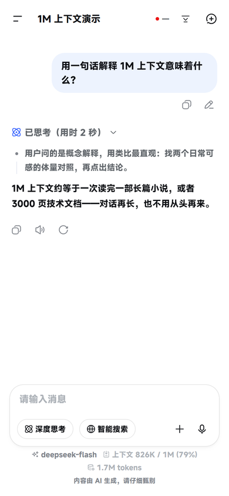
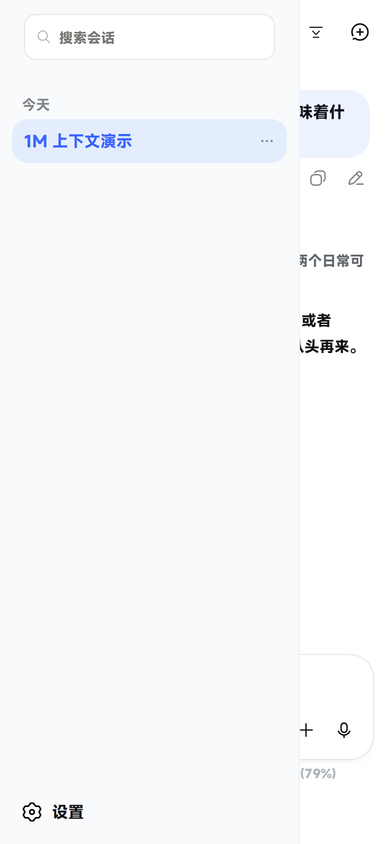
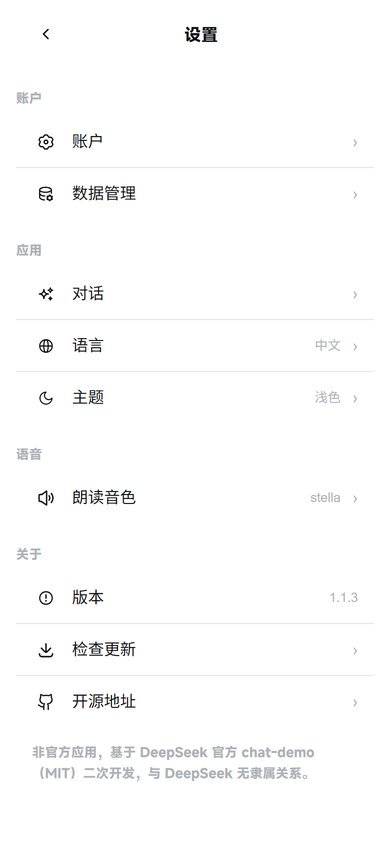
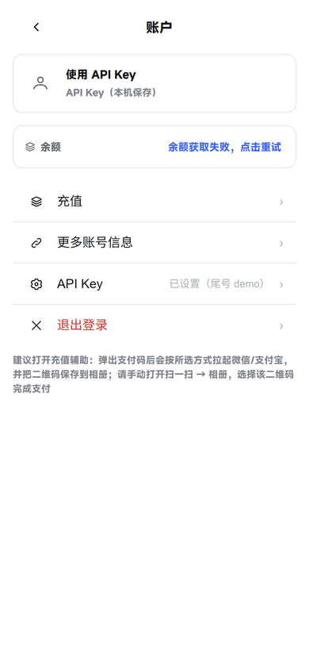

<div align="center">

<a href="README.md">English</a> ｜ <b>简体中文</b>

<br>

<div>
<a href="https://github.com/moyuer233/deepseek-chat-demo-android/releases/latest"></a>
<a href="https://github.com/moyuer233/deepseek-chat-demo-android/actions/workflows/ci.yml"></a>
<a href="https://github.com/moyuer233/deepseek-chat-demo-android/blob/main/LICENSE"></a>
<a href="https://github.com/moyuer233/deepseek-chat-demo-android/releases"></a>
<a href="https://github.com/moyuer233/deepseek-chat-demo-android/releases"></a>
<a href="https://github.com/moyuer233/deepseek-chat-demo-android/stargazers"></a>
</div>

<br>

<a href="https://moyuer233.github.io/deepseek-chat-demo-android/">官网</a> ｜
<a href="https://github.com/moyuer233/deepseek-chat-demo-android/releases">下载</a> ｜
<a href="https://github.com/moyuer233/deepseek-chat-demo-android/issues">问题反馈</a> ｜
<a href="https://github.com/deepseek-ai/chat-demo">上游 chat-demo</a>

</div>

DeepSeek Chat Demo Android 是一个开源的非官方安卓客户端：用**你自己的 API Key 或 DeepSeek 开放平台账号授权**聊天，额度与账单都在你自己账号里，因此不受官方免费版限流影响；同时把 chat.deepseek.com 的历史会话整包导入本机，随时可再导出带走。网页内核复用 chat-demo（MIT），原生外壳用 Kotlin + Compose 编写。



## 主要功能

1. 💬 **用自己的 API 聊天**：直连 `api.deepseek.com`，填 API Key 或用 DeepSeek 开放平台账号授权（免 Key），请求不经过任何中转。
2. 🧠 **1M 上下文，看得见**：输入框下方实时显示模型、上下文占用与累计 tokens；接近上限时只在本机把旧对话压成摘要，**本机原文一条不删**。
3. 🗂️ **历史整包导入**：在 chat.deepseek.com 导出会话 ZIP，导入前给出「新增 / 有更新 / 本地独有」差异预览，可选合并、仅新增或覆盖替换；导入后可再导出 `deepseek_data-*.zip`。
4. 🔍 **深度思考与智能搜索**：思考过程可展开，与回答分开渲染；联网结果作为引用出现在回答里。
5. 🖼️ **附件与语音**：拍照、相册、文件三入口，PDF 能读、图片能描述；朗读回复，按住说话松手转文字。
6. 🌿 **消息分支**：重新生成、编辑重发都会留分支，左右切换不丢旧答案。
7. 💳 **账户与充值**：账户页看余额与赠送额度；内置充值页识别支付码，按你选的微信/支付宝拉起对应 App，可选「扫码辅助」在 20 秒内自动进扫一扫相册。
8. 📱 **原生外壳**：相机、相册、文件、麦克风走系统能力；返回键逐级后退、右滑开侧栏；Release 开 R8，APK 约 2.9 MB。
9. 🌏 **中英双语**：界面文案中文为基准，英文按中文原意翻译。

## 界面

<table>
  <tr>
    <td align="center"><br />聊天：状态行显示上下文占用</td>
    <td align="center"><br />侧栏：搜索 + 按时间分组的会话</td>
  </tr>
  <tr>
    <td align="center"><br />设置：账户 / 应用 / 语音 / 关于</td>
    <td align="center"><br />账户：余额、充值、API Key</td>
  </tr>
</table>

## 快速开始

### 直接安装

从 [Releases](https://github.com/moyuer233/deepseek-chat-demo-android/releases) 下载 APK（当前 **1.1.3**，versionCode 9，约 2.9 MB），Android 7.0 及以上，自签名。

装好后二选一：填自己的 API Key，或用 DeepSeek 开放平台账号授权（免 Key）。

### 从源码构建

需要 Node.js、pnpm、JDK 21、Android SDK 36：

```bash
pnpm install && pnpm build
rm -rf native-app/app/src/main/assets/web && mkdir -p native-app/app/src/main/assets/web
cp -r dist/. native-app/app/src/main/assets/web/
cd native-app && ./gradlew assembleRelease   # 签名配置在 native-app/keystore.properties
```

### 导入历史会话

1. 在浏览器打开 [chat.deepseek.com](https://chat.deepseek.com)，从官方导出入口拿到会话 ZIP。
2. App 里进入「设置 → 数据管理 → 导入历史对话」，选择该 ZIP。
3. 确认「新增 / 有更新 / 本地独有」差异后导入。

## 支持的能力

| 类别 | 内容 |
| --- | --- |
| 模型 | `deepseek-flash`、`deepseek-v4-pro`（均 1M 上下文） |
| 聊天 | 流式回复、停止、重新生成、编辑重发、继续生成、分支切换、复制、赞踩、朗读 |
| 附件 | 拍照、相册、文件；图片描述、PDF 阅读；附件随归档一起导出 |
| 语音 | 按住说话（上滑取消）、账号音色朗读 |
| 数据 | 导入/导出 `deepseek_data-*.zip`、差异预览、上下文压缩、用量统计 |
| 账户 | 余额与赠送额度、充值（微信/支付宝）、API Key 管理、可选扫码辅助 |
| 平台 | Android 7.0+（minSdk 24），targetSdk 36 |

## 项目结构

| 路径 | 说明 |
| --- | --- |
| `src/` | chat-demo 网页客户端（React 18 + rspack） |
| `native-app/` | 安卓原生外壳（Kotlin + Compose + WebView + `window.NativeShell` 桥） |
| `copy/文案.mjs` | 网页与原生文案的唯一来源，`node scripts/gen-copy.mjs` 生成各端文件 |
| `site/` | 官网静态页（GitHub Pages 发布） |
| `docs/` | 截图与调研记录 |

## 已知限制

- 长会话目前只渲染最近 25 条，更早的消息按需展开；虚拟滚动尚未实现（计划见项目内规范）。
- 没有自动化测试，回归主要靠手动与 OCR 审查。
- 充值页只返回银联聚合码，微信/支付宝的渠道靠页面选择与二维码内容判断。

## 说明

- 聊天请求直连 `api.deepseek.com`，不经过本项目的中转服务器；额度与计费归你的账号。
- 会话与导入的历史存在手机本地（IndexedDB）；登录在官方授权页完成，App 不接触密码，授权 token 由 Android Keystore 加密保存。
- 「扫码辅助」是可选的无障碍服务，默认关闭，只在充值拉起微信/支付宝后的 20 秒内动作，不读取、不存储聊天或支付信息。

## 许可

MIT © moyuer233。网页内核复用自 MIT 许可的 [chat-demo](https://github.com/deepseek-ai/chat-demo)，其版权声明保留在 [NOTICE](NOTICE)。DeepSeek 名称与图标归深度求索所有，本项目为非官方项目，与 DeepSeek 无隶属或背书关系。
